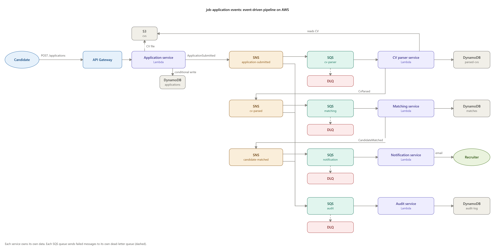

# Apply Relay

An event-driven job application pipeline on AWS, built from five small services that talk only through events (SNS → SQS).

When a candidate applies for a job, several things have to happen: read the CV, score the candidate against the job, tell the recruiter and keep an audit trail. If one big service did all of that, a slow CV parser would block everything and a double-clicked "Apply" button would create duplicate applications. Here, each step is its own service, reacts to an event, retries on its own, and can fail without taking the others down.

## Why I built this

I wanted to practise building an event-driven system on AWS end to end, the way it happens on a real project: start from an idea, write down the requirements, make the technical decisions and record why, then build not only the application code but also the infrastructure underneath it, as Terraform, deployed to AWS by a CI/CD pipeline. I built it working with Claude (Claude Code) as a pair-programming partner.

## Why event-driven

I've worked on backends where services talk to each other with plain HTTP request/response. That works well for asking a question and waiting for the answer. It gets painful when one service has to tell several others that something happened: the caller has to know every receiver, waits for each one, and has to handle retries itself when one of them is down.

Events aren't the only way to connect microservices, but for a workflow like this one they scale and cope with failure better:

* The producer publishes an event and moves on. It doesn't know or care who listens.
* Each consumer has its own queue, so a slow or broken service doesn't hold up the others, and its messages wait for it instead of being lost.
* Adding a consumer is a new subscription, not a change to the producer. The audit service was added this way.

It has a price: the system is eventually consistent, a message can arrive twice, and following one request across services is harder. Most of [Reliability](#reliability) and [Observability](#observability) below exists to deal with exactly that.

## Architecture



Every queue has a dead-letter queue (DLQ): a message that fails 3 times is parked there and raises a CloudWatch alarm instead of retrying forever.

## Services

| Service | Listens to | Publishes | Owns |
|---|---|---|---|
| [Application](services/application/) | HTTP `POST /applications` | `ApplicationSubmitted` | `applications` table, `cvs` bucket |
| [CV parser](services/cv_parser/) | `ApplicationSubmitted` | `CvParsed` | `parsed-cvs` table |
| [Matching](services/matching/) | `CvParsed` | `CandidateMatched` | `matches` table, job requirements |
| [Notification](services/notification/) | `CandidateMatched` | nothing | `notifications` table (sent log) |
| [Audit](services/audit/) | all three events | nothing | `audit-log` table |
| [Alerts](services/alerts/) | CloudWatch alarms (SNS `alarms`) | readable emails (SNS `ops-alerts`) | nothing |

Each service owns its own data. No service reads another service's table; everything it needs arrives in an event or is stored by itself.

## Events

All events share one [envelope](docs/events/envelope.schema.json):

```json
{
  "event_id": "0b7c5a52-6a7e-4f0e-9c1a-2a8f3b1d9e44",
  "event_type": "ApplicationSubmitted",
  "event_version": 1,
  "occurred_at": "2026-10-05T18:40:00Z",
  "correlation_id": "app_5f1d7a0c9e2b",
  "producer": "application-service",
  "data": { "...": "event-specific payload" }
}
```

* `event_id` is unique per event, so consumers can safely ignore a message delivered twice (SQS guarantees *at least once*, not *exactly once*).
* `correlation_id` is the application ID. It travels through every event, so one application can be traced end to end.
* `event_version` lets a payload change without breaking older consumers.

| Event | Payload schema |
|---|---|
| `ApplicationSubmitted` | [application-submitted.schema.json](docs/events/application-submitted.schema.json) |
| `CvParsed` | [cv-parsed.schema.json](docs/events/cv-parsed.schema.json) |
| `CandidateMatched` | [candidate-matched.schema.json](docs/events/candidate-matched.schema.json) |

## Reliability

| Risk | How it's handled |
|---|---|
| Candidate clicks "Apply" twice | The application ID is derived from candidate email + job ID, and DynamoDB writes it with a condition (`attribute_not_exists`). The second request gets the original application back, and no second event is published. |
| SQS delivers a message twice | Each consumer records processed `event_id`s and skips repeats. |
| A service is down or throws | SQS keeps the message and retries; after 3 failures it moves to the DLQ and an alarm fires. Other services are unaffected. |
| A bad message blocks a queue | Lambda reports partial batch failures, so only the failing message is retried. |
| "Where did this application get stuck?" | `correlation_id` in every log line plus AWS X-Ray traces across services. |

## Observability

| Question | Where to look |
|---|---|
| Is anything broken right now? | 10 CloudWatch alarms email you when a dead-letter queue gets a message, a queue has a backlog older than 15 minutes, or the API returns 5xx. The alerts service rewrites each one as "what happened / what to do / links" |
| How is the pipeline doing? | the `apply-relay-dev-pipeline` CloudWatch dashboard (`terraform output dashboard_url`) |
| What happened to application `app_...`? | `python scripts/trace_application.py app_...` reads its event history from the audit log |
| Where did it get slow or fail? | X-Ray: Lambdas and SNS topics have active tracing, so one application is one connected trace across all five services |
| What did the services log about it? | the saved Logs Insights query `apply-relay-dev/trace-one-application`; every log line is JSON with `correlation_id` |

## Tech stack

Python 3.12 · AWS Lambda · API Gateway · SNS · SQS · DynamoDB · S3 · SES · CloudWatch · X-Ray · Terraform · GitHub Actions (OIDC, no stored AWS keys)

The stack is 100% serverless: no servers to patch, capacity follows traffic automatically (including bursts, like a wave of applications right after a job is posted), and it costs close to nothing while idle.

### Why Lambda instead of ECS Fargate

Each service does a few seconds of work per message, and traffic comes in bursts with long quiet periods in between. Lambda fits that: it runs only when there's a message, and its SQS integration takes care of polling, batching, retries and partial batch failures. Fargate tasks would run (and bill) around the clock, and each service would need its own polling loop and autoscaling.

The trade-offs are cold starts and the 15-minute limit per run. Neither matters here, and because services only share events, any one of them could move to Fargate later without touching the others. More in [ADR 0001](docs/decisions/0001-lambda-over-fargate.md).

### Why SNS + SQS fan-out

In this workflow, one event usually has several independent consumers. `ApplicationSubmitted` goes to the CV parser and the audit log. `CandidateMatched` goes to the audit log and, for strong matches only, to the notification service. SNS does the fan-out, and the filtering through a subscription filter policy. An SQS queue per consumer gives each service its own buffer, retries and dead-letter queue.

EventBridge would also work, but would still need SQS behind it for buffering. Amazon MQ (RabbitMQ) means a broker that runs, bills and needs patching all the time. Lambdas calling each other directly would bring back exactly the coupling I wanted to avoid. More in [ADR 0002](docs/decisions/0002-sns-sqs-fanout.md).

## Project layout

```
├── docs/
│   ├── events/        # JSON Schemas: the contracts between services
│   └── decisions/     # architecture decision records
├── services/          # one folder per microservice (code, tests, own README)
├── scripts/           # build_lambda.py: packages a service with its dependencies
├── infra/             # Terraform
└── .github/workflows/ # CI on pull requests, deploy on main
```
