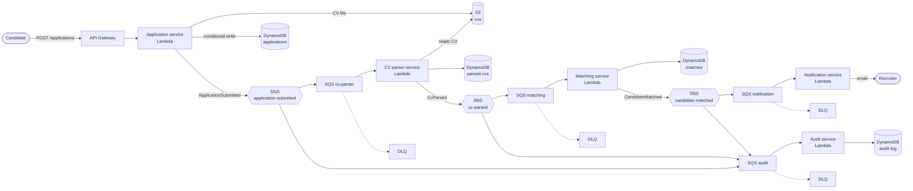

# Job Application Events

An event-driven job application pipeline on AWS, built from five small services that talk only through events (SNS → SQS).

When a candidate applies for a job, several things have to happen: read the CV, score the candidate against the job, tell the recruiter and keep an audit trail. If one big service did all of that, a slow CV parser would block everything and a double-clicked "Apply" button would create duplicate applications. Here, each step is its own service, reacts to an event, retries on its own, and can fail without taking the others down.

## Architecture



Every queue has a dead-letter queue (DLQ): a message that fails 3 times is parked there and raises a CloudWatch alarm instead of retrying forever.

## Services

| Service | Listens to | Publishes | Owns |
|---|---|---|---|
| [Application](services/application/) | HTTP `POST /applications` | `ApplicationSubmitted` | `applications` table, `cvs` bucket |
| [CV parser](services/cv_parser/) | `ApplicationSubmitted` | `CvParsed` | `parsed-cvs` table |
| [Matching](services/matching/) | `CvParsed` | `CandidateMatched` | `matches` table, job requirements |
| [Notification](services/notification/) | `CandidateMatched` | nothing | `notifications` table (sent log) |
| [Audit](services/audit/) | all three events | nothing | `audit-log` table |

Each service owns its own data. No service reads another service's table; everything it needs arrives in an event or is stored by itself.

## Events

All events share one [envelope](docs/events/envelope.schema.json):

```json
{
  "event_id": "0b7c5a52-6a7e-4f0e-9c1a-2a8f3b1d9e44",
  "event_type": "ApplicationSubmitted",
  "event_version": 1,
  "occurred_at": "2026-10-05T18:40:00Z",
  "correlation_id": "app_5f1d7a0c9e2b",
  "producer": "application-service",
  "data": { "...": "event-specific payload" }
}
```

* `event_id` is unique per event, so consumers can safely ignore a message delivered twice (SQS guarantees *at least once*, not *exactly once*).
* `correlation_id` is the application ID. It travels through every event, so one application can be traced end to end.
* `event_version` lets a payload change without breaking older consumers.

| Event | Payload schema |
|---|---|
| `ApplicationSubmitted` | [application-submitted.schema.json](docs/events/application-submitted.schema.json) |
| `CvParsed` | [cv-parsed.schema.json](docs/events/cv-parsed.schema.json) |
| `CandidateMatched` | [candidate-matched.schema.json](docs/events/candidate-matched.schema.json) |

## Reliability

| Risk | How it's handled |
|---|---|
| Candidate clicks "Apply" twice | The application ID is derived from candidate email + job ID, and DynamoDB writes it with a condition (`attribute_not_exists`). The second request gets the original application back, and no second event is published. |
| SQS delivers a message twice | Each consumer records processed `event_id`s and skips repeats. |
| A service is down or throws | SQS keeps the message and retries; after 3 failures it moves to the DLQ and an alarm fires. Other services are unaffected. |
| A bad message blocks a queue | Lambda reports partial batch failures, so only the failing message is retried. |
| "Where did this application get stuck?" | `correlation_id` in every log line plus AWS X-Ray traces across services. |

## Observability

| Question | Where to look |
|---|---|
| Is anything broken right now? | 9 CloudWatch alarms email you: a dead-letter queue got a message, a queue has a backlog older than 15 minutes, or the API returns 5xx |
| How is the pipeline doing? | the `jae-dev-pipeline` CloudWatch dashboard (`terraform output dashboard_url`) |
| What happened to application `app_...`? | `python scripts/trace_application.py app_...` reads its event history from the audit log |
| Where did it get slow or fail? | X-Ray: Lambdas and SNS topics have active tracing, so one application is one connected trace across all five services |
| What did the services log about it? | the saved Logs Insights query `jae-dev/trace-one-application`; every log line is JSON with `correlation_id` |

## Design decisions

* [0001: Lambda instead of ECS Fargate](docs/decisions/0001-lambda-over-fargate.md)
* [0002: SNS + SQS fan-out instead of EventBridge or RabbitMQ](docs/decisions/0002-sns-sqs-fanout.md)

## Tech stack

Python 3.12 · AWS Lambda · API Gateway · SNS · SQS · DynamoDB · S3 · SES · CloudWatch · X-Ray · Terraform · GitHub Actions (OIDC, no stored AWS keys)

## Roadmap

- [x] 1. Repo skeleton, event contracts, architecture
- [x] 2. Shared infrastructure in Terraform (topics, queues, DLQs, budget alarm)
- [x] 3. Application service
- [x] 4. CV parser service
- [x] 5. Matching service
- [x] 6. CI/CD with GitHub Actions
- [x] 7. Notification and audit services, tracing and alarms

## Project layout

```
├── docs/
│   ├── events/        # JSON Schemas: the contracts between services
│   └── decisions/     # architecture decision records
├── services/          # one folder per microservice (code, tests, own README)
├── scripts/           # build_lambda.py: packages a service with its dependencies
├── infra/             # Terraform
└── .github/workflows/ # CI on pull requests, deploy on main
```
